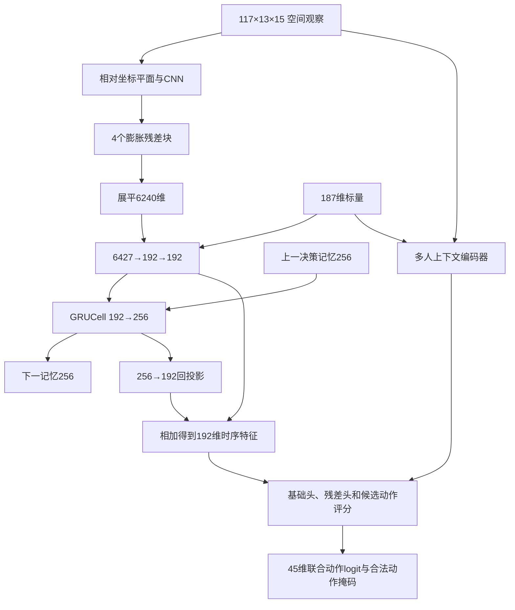

# ONNX策略网络架构

模型是带循环记忆的卷积策略网络，变体为`unified-candidate-v1`，架构版本2、张量版本18、部署契约版本2。单个ONNX文件为每个角色计算动作评分；各角色使用独立记忆，没有额外的独立逃生模型。

## 部署接口

| 输入 | 类型 | 形状 |
| --- | --- | --- |
| `spatial` | float32 | `[batch,117,13,15]` |
| `scalars` | float32 | `[batch,187]` |
| `legal` | bool | `[batch,45]` |
| `memory` | float32 | `[batch,256]` |
| `reset` | bool | `[batch]` |

输出为float32的`logits [batch,45]`和`next_memory [batch,256]`，batch为动态维。策略参数共3,241,805，部署图不输出价值估计。

## 主干与记忆

1. 根据角色位置追加相对行列坐标平面，117通道变为119通道。
2. 三层3×3卷积：`119→24→32→32`，stride1、padding1，每层使用SiLU。
3. 四个32通道残差块，膨胀率为`1,2,4,1`。每块为深度3×3卷积、SiLU、`1×1:32→64`、SiLU、`1×1:64→32`及残差相加。
4. 保留13×15棋盘位置，展平为6240维；拼接187维标量后，经`6427→192`、LayerNorm、SiLU、`192→192`和SiLU。
5. `GRUCell(192,256)`更新记忆。新记忆经`256→192`投影，与当前编码相加，形成192维时序特征。

## 策略评分

各分支的输出相加得到最终logit：

| 分支 | 结构 |
| --- | --- |
| 基础动作头 | `192→45` |
| 行为路由与5个风格残差 | `8→32→5`路由，softmax加权5个`192→45`头 |
| 多人残差 | `192→45`及独立的同规格空间/标量编码器后接`192→45` |
| 战术残差 | `sigmoid(192→1) × Linear(192→45)` |
| 24维候选评分 | 状态、邻格、标量、14维方向后果与动作嵌入映射到24维，再`SiLU→24→1` |
| 48维后果评分 | 状态、32维动作后果、动作嵌入映射到48维，再`SiLU→48→1` |
| 96维交互评分 | 状态、32维后果与动作嵌入各96维，拼接后`288→128→96→1` |
| 动作因子 | 方向`192→5`、放泡意图`192→2`、道具意图`192→8`，映射回联合动作评分 |

多人分支受公开队伍/人数状态门控。网络的观察编码来自[battleenv](https://github.com/kuuhaku1314/qqtang/blob/main/internal/game/battleenv/encoding.go)，包含地形、角色、糖泡、危险、可见道具和公开状态，并非游戏截图。动作后果特征是当前世界的估计，不保证未来安全。

## 联合动作

| ID | 语义 |
| --- | --- |
| 0 | 等待 |
| 1–4 | 上、右、下、左 |
| 5 | 原地放泡 |
| 6–9 | 四方向移动并放泡 |
| 10–16 | 原地使用7种固定身份道具动作：41、42、43、44、46、63、64 |
| 17–44 | 上述道具与四方向移动的组合 |

模型输出logit，运行端在合法动作上按配套元数据采样或选择动作。MinP、温度和随机数属于解码设置，不是额外网络层；以实际模型JSON为准。

## 记忆与部署

服务端按房间和角色保存`next_memory`，在该角色下一次实际决策时作为`memory`回传，对局开始或重置时清零。不同角色之间不共享隐藏状态，也不在每个引擎tick都更新网络记忆。

模型及配套JSON见[configs/models](../configs/models)。运行时使用CPU ONNX Runtime，无需Python或GPU。构建服务端须启用`CGO_ENABLED=1`和`-tags onnxruntime`，并保留对应平台运行库；模型更新时同时替换ONNX和元数据，重启服务端加载。
